<div align="center">

# 🌲 LOST IN THE FOREST (`JUST_CHECKING`)

**A 3D Third-Person Story-Driven Action-Adventure & Survival Game built with Godot Engine 4**

[](https://godotengine.org/)
[](https://github.com/godot-jolt/godot-jolt)
[](https://godotengine.org/)
[](https://docs.godotengine.org/)

<br />

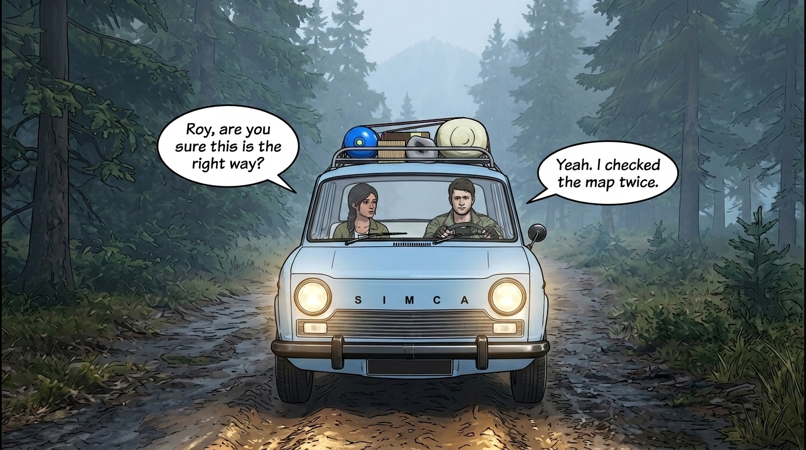

</div>

---

## 📖 Overview & Storyline

**Lost in the Forest** follows **Roy** and **Jessica**, who head deep into a remote, mist-covered forest for a peaceful camping trip. When dawn breaks, Roy wakes up at the campsite to find Jessica missing—abducted by the sinister **Forest Master (Villain Boss)** and his army of cursed wooden mannequin puppets.

Armed only with his wits, a 9mm pistol, and a trail of taunting parchment notes left behind by the Boss, Roy must:
1. **Investigate the Forest Trail** and uncover all **3 Boss Clue Notes**.
2. **Battle through Forest Minions** patrolling the woods and riverbanks.
3. **Confront the Villain Boss** face-to-face and survive the **Cage Ambush**.
4. **Defeat the Boss**, claim the **Golden Cage Key**, and unlock **Jessica's Cage**.
5. **Protect Jessica** during a high-stakes **Siren & Horde Extraction** all the way back to the **Escape Car**!

---

## 🖼️ Comic Cinematics & Gameplay Gallery

### 🎬 Voice-Acted Intro Comic Sequence
| Panel 1: Arrival in the Woods | Panel 4: Night by the Campfire |
| :---: | :---: |
|  | 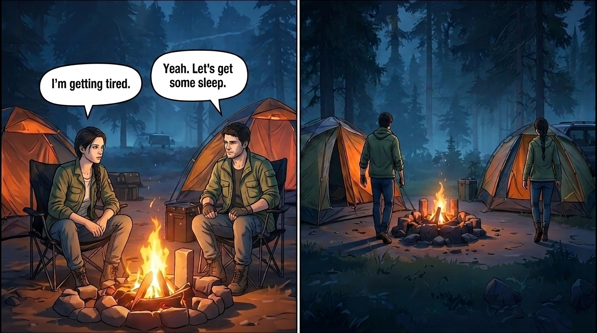 |
| **Panel 5: Dawn Discovery** | **Panel 6: Roy's Oath** |
| 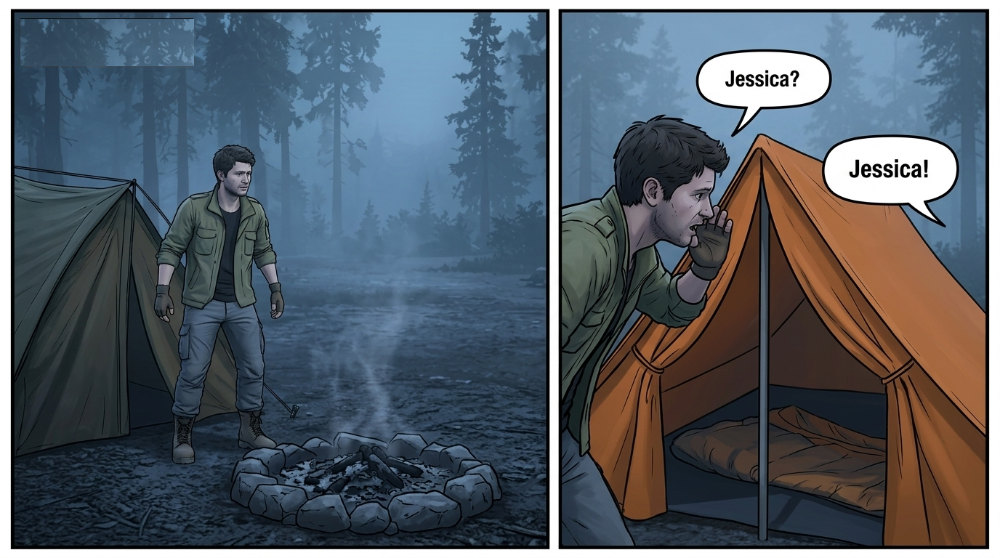 | 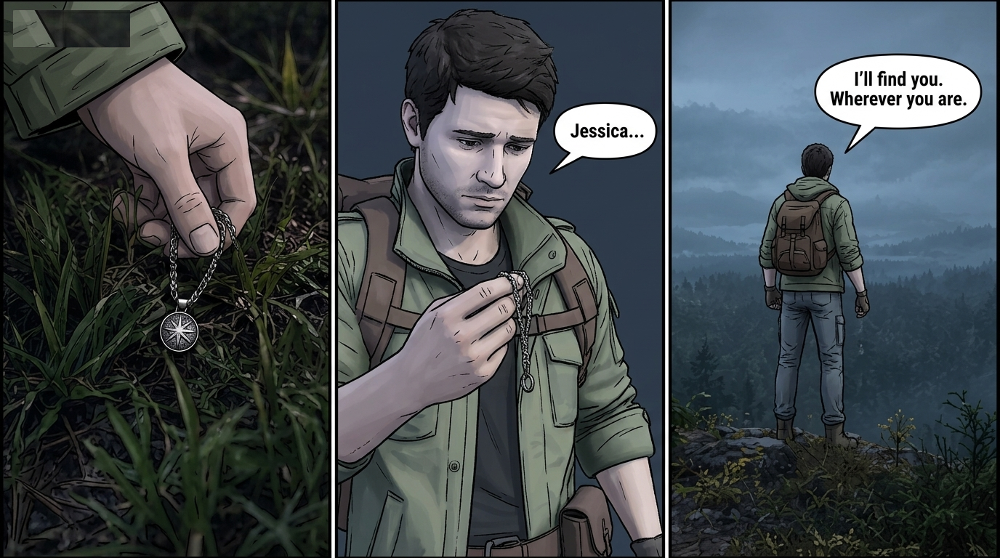 |

### 🎮 Core Mechanics & In-Game Visuals
| Item Pickup & Inventory | Health & Apple Healing |
| :---: | :---: |
| 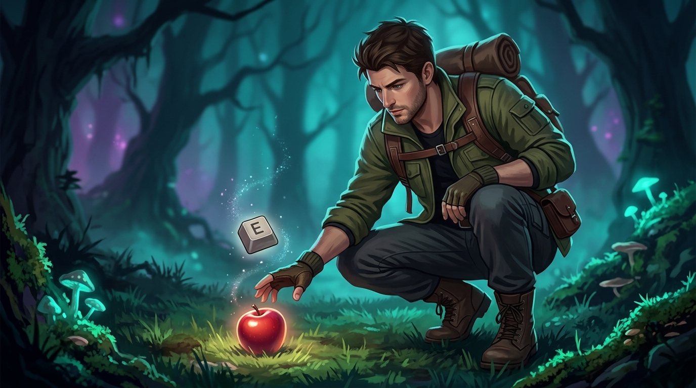 | 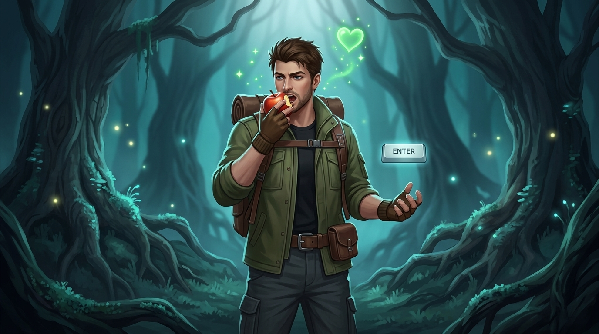 |
| **Stamina & Sprint System** | **Third-Person Pistol Combat** |
| 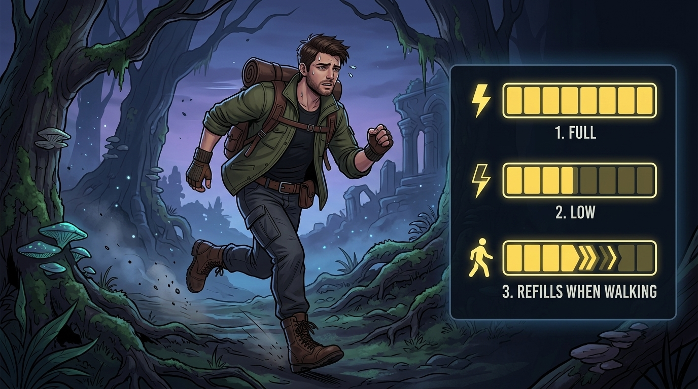 | 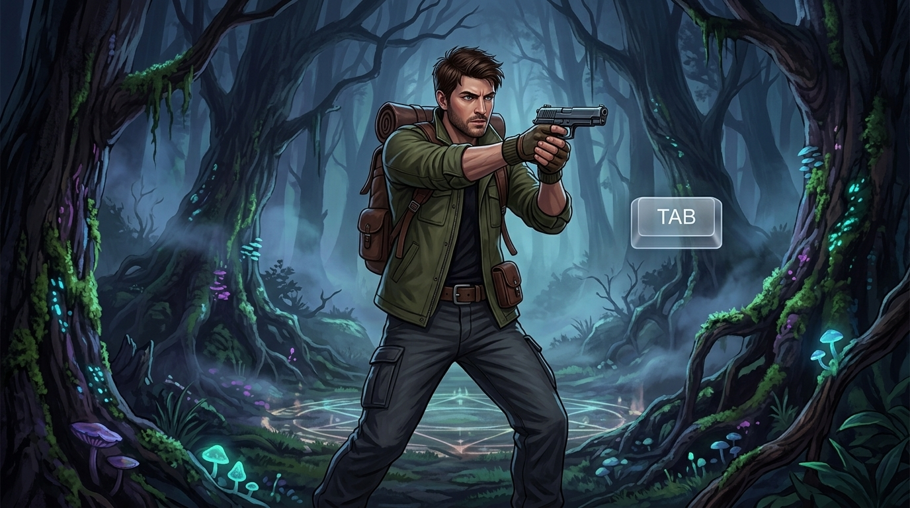 |

### 🚗 Finale Escape Comic Sequence
| Chased by the Horde | Reaching the Escape Car |
| :---: | :---: |
| 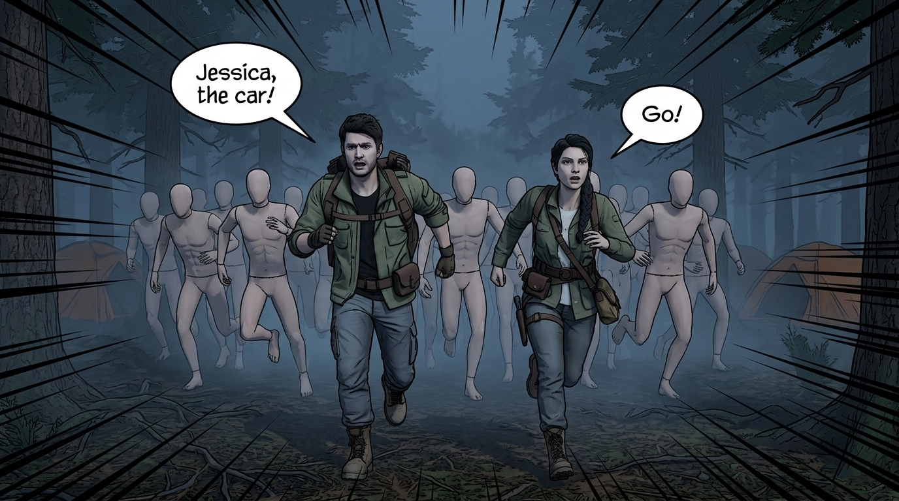 | 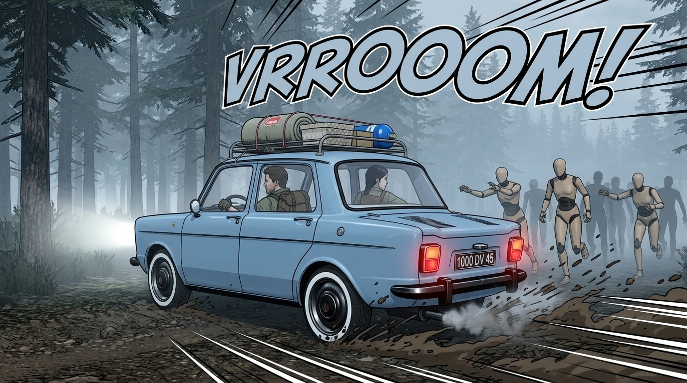 |

---

## ✨ Key Features

- **🎭 Full Story Quest Progression (`StoryQuestManager`)**:
  - 8-stage state machine guiding the player from exploration and clue hunting to boss encounters, ambush waves, rescue, and horde extraction.
  - Dynamic **Parchment Scroll Objective Tracker** on the HUD and interactive **Torn-Paper Clue Reader**.
- **🎥 Cinematic Dialogue & Cutscene System**:
  - Dynamic camera framing (`CinematicDialogueCam`) with automatic line-of-sight raycasting, terrain clearance, smooth cubic tweens, and camera shake during screams and horde emergence.
  - Full character voice acting for **Roy**, **Jessica**, and the **Villain Boss**.
- **🔫 Third-Person Shooter & Survival Mechanics (`roy.gd`)**:
  - **9mm Pistol Combat**: Equip/unequip toggle (`TAB`), raycast shooting, magazine & reserve ammo management (`12 / 60`), manual & auto-reloading (`R`), custom muzzle flash, bullet tracers, and surface impact VFX.
  - **Movement & Water Physics**: Walking, sprinting (with dynamic FOV zoom & motion blur), crouching, jumping, and buoyancy-based **river swimming**.
  - **Health, Stamina & Hotbar Inventory**: Collect apples to heal (`+25 HP`), pick up ammo boxes and keys, and manage items via a custom Hotbar UI.
- **🤖 Enemy AI & Boss Mechanics (`enemy.gd`)**:
  - Multi-state AI (`IDLE`, `PATROL`, `CHASE`, `ATTACK`, `HIT`, `DEAD`) with obstacle avoidance, group alerting, and 3D billboard health bars.
  - **Ground Emergence VFX**: Ambush and horde minions rise dynamically from the forest floor with dust particle effects.
  - **Boss Waypoint Retreat & Key Drop**: The Villain Boss taunts Roy, retreats to the cage clearing, summons 4 mannequin guards, and drops the Golden Key upon defeat.
- **🏃‍♀️ Companion Rescue & Escort AI (`female.gd`)**:
  - Once unlocked from the iron cage, **Jessica** follows Roy toward the highlighted **Escape Car** (complete with a golden extraction ring, sky beam, and live distance marker).
  - Distance check warning (`⚠️ WAIT FOR JESSICA!`) ensures the player protects her while up to 14 horde minions spawn in pursuit.
- **🎨 Custom Shaders & Environment**:
  - Stylized post-processing outline/toon shaders (`new_shader.gdshader`, `new_shader_2.gdshader`), animated wind foliage (`wind!.gdshader`), refractive water shaders, **LowPolyTerrain**, and **SimpleGrassTextured**.

---

## 🎮 Controls

| Key / Input | Action |
| :--- | :--- |
| `W` `A` `S` `D` | Move Forward, Left, Backward, Right |
| `Mouse` | Look / Aim Camera (360° Horizontal, Clamped Vertical) |
| `Shift` | Sprint / Run (Consumes Stamina) |
| `Ctrl` | Crouch |
| `Space` | Jump / Swim Upward / Advance Dialogue or Comic Panel |
| `Tab` | Equip / Unequip 9mm Pistol |
| `Left Mouse Click` | Fire Pistol (when equipped) |
| `R` | Reload Pistol / Respawn (when dead) |
| `E` | Interact (Pick up items, Read Boss Clues, Unlock Jessica's Cage) |
| `Enter` | Eat Apple (Heal `+25 HP` from ground or inventory) |
| `Q` | Drop Selected Inventory Item |
| `Esc` | Skip Intro/Ending Comic or Close Clue Reader |

---

## 🗺️ Quest Progression Flow

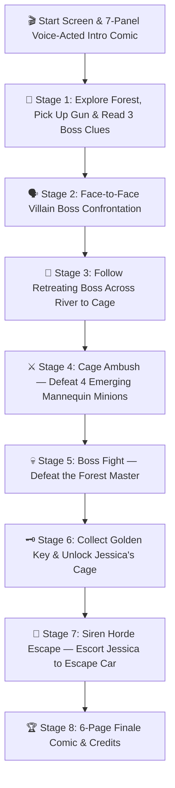

---

## 📂 Project Structure

```text
--GAME-WORKING--/
└── GAME-4/
    └── -just-checking/
        ├── project.godot              # Godot 4.7 project configuration (Forward+, Jolt Physics)
        ├── scene/                     # Game scenes (.tscn / .scn)
        │   ├── start_screen.tscn      # Main menu with video background & audio
        │   ├── intro_comic.tscn       # 7-page voice-acted intro comic sequence
        │   ├── world.tscn             # Main 3D forest level, terrain, river, enemies & props
        │   ├── jessica_cage.tscn      # Iron cage & trapped companion setup
        │   ├── end_screen.tscn        # 6-page finale escape comic & credits
        │   └── enemies/               # Boss (enemy_1) and Mannequin Minion (enemy_2, enemy_3) scenes
        ├── script/                    # Core GDScript gameplay systems
        │   ├── roy.gd                 # Player controller, combat, swimming, health/stamina, HUD
        │   ├── story_quest_manager.gd # 8-stage story quest state machine, cutscenes & horde logic
        │   ├── enemy.gd               # ForestEnemy AI, patrol/chase/attack, overhead HP, loot drops
        │   ├── female.gd              # Jessica NPC companion follow & swimming AI
        │   ├── dialogue_box.gd        # Cinematic subtitle & voice playback system
        │   ├── hotbar.gd              # Inventory hotbar management
        │   ├── tutorial_screen.gd     # Interactive stacked-card tutorial overlay
        │   ├── intro_comic.gd         # Ken Burns animated intro comic controller
        │   └── end_screen.gd          # Finale comic & SFX badge controller
        ├── vfx/                       # Custom 3D visual effects
        │   ├── muzzle_flash.tscn      # Gunfire flash VFX
        │   ├── bullet_tracer.tscn     # Projectile beam tracer
        │   ├── bullet_impact.tscn     # Surface hit spark VFX
        │   ├── enemy_hit_vfx.tscn     # Blood/spark hit reaction VFX
        │   ├── enemy_death_vfx.tscn   # Toon cloud puff death & cage unlock VFX
        │   └── ground_emerge_dust_vfx.tscn # Minion ground emergence dust particles
        ├── addons/                    # Godot Editor plugins
        │   ├── lowpolyterrain/        # Low-poly procedural/sculpted terrain system
        │   ├── simplegrasstextured/   # Interactive wind-animated 3D grass system
        │   └── proton_scatter/        # Procedural foliage & prop scattering
        └── import/                    # 3D models, animations, UI textures, fonts, voiceover & SFX
```

---

## 🚀 Getting Started (How to Run)

1. **Clone the Repository**:
   ```bash
   git clone https://github.com/Muhammad-wasay/--GAME-WORKING--.git
   cd --GAME-WORKING--
   ```
2. **Open in Godot Engine**:
   - Download and launch **Godot Engine 4.x** (configured with Godot `4.7` / Forward+ and **Jolt Physics**).
   - Click **Import** in the Godot Project Manager and select:
     ```text
     GAME-4/-just-checking/project.godot
     ```
3. **Run the Game**:
   - Press **`F5`** (or click the **Play** button in the top-right corner of the editor) to launch from the Start Screen (`start_screen.tscn`).

---

## 👤 Author

**Muhammad Wasay**
- GitHub: [@Muhammad-wasay](https://github.com/Muhammad-wasay)
